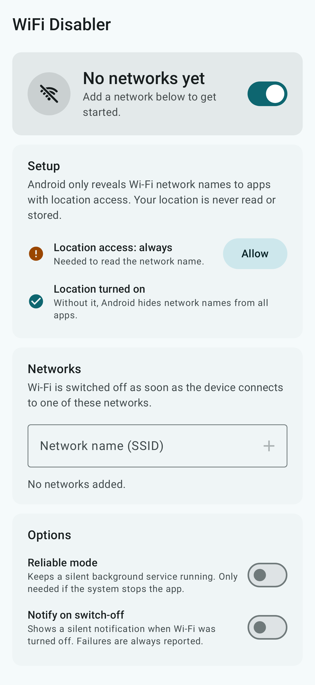

<div align="center">

🇩🇪 <a href="README.md">Deutsch</a> &nbsp;·&nbsp; 🇬🇧 <b>English</b>


# WiFi Disabler

**Turns Wi-Fi off automatically as soon as your Android device connects to a network you chose.**

[Download](../../releases/latest) · [Setup](#setup) · [Features](#features)

</div>

<table>
<tr>
<td width="33%"></td>
<td width="33%"></td>
<td width="33%"></td>
</tr>
</table>

## Setup

Download `WiFi-Disabler-vX.Y.Z.apk` from [Releases](../../releases/latest) and install it. Android or Play Protect
will warn that the app was built for an older version of Android. That is intended (see
[Why Android 9?](#why-android-9)), so choose *Install anyway*.

1. **Add a network:** tap *Add “…”* while connected, or type its name (SSID).
2. **Location › Allow all the time:** Android only reveals Wi-Fi names to apps with location access, also in the background.
3. **Keep location turned on:** with location off, Android hides network names from every app.

That's it. The app only shows steps that are still missing. If the system stops the app in the background,
*Battery › Unrestricted*, *Autostart* in the app settings or **reliable mode** in the app help.
Device-specific guides are on [dontkillmyapp.com](https://dontkillmyapp.com).

> If you only never want to join a network again, you don't need an app: forget the network or turn off
> *Auto-connect* in the Wi-Fi settings.

## Features

| | |
|---|---|
| **Network list** | Add the current network with one tap or type an SSID |
| **Unobtrusive** | No permanent notification, no questions after setup |
| **Reliable mode** | Optional silent background service for systems that stop apps |
| **Tile** | Pause and resume from Quick Settings |
| **Log** | The last 20 switch-offs, stored locally only |
| **Language** | German or English, following the system |

## Why Android 9?

Since Android 10, only apps that target Android 9 (API 28) may switch Wi-Fi off via `setWifiEnabled()`. For all
others it silently does nothing; the only official alternatives are root, Shizuku/ADB or device owner. The app
therefore targets API 28 on purpose. That works without root from Android 8 to today, but rules out Google Play.
Should Android ever stop installing apps with this target, a Shizuku or root path can be added.

Limits: Wi-Fi can only be switched off *after* the connection exists, so a few seconds of traffic through that
network are possible. Wi-Fi then stays off. Matching is by name only, any network with the same SSID triggers.

## Privacy

No account, no ads, no tracking and no internet permission. Only the network list, settings and log are stored,
on the device only.

The location permission is used solely to read the Wi-Fi name; the app never requests a position. Notifications
and the foreground service are only used for reliable mode and the optional notices. If Android's device backup
is enabled, the system may include the settings in it.

## Build

```sh
./gradlew assembleRelease
```

Every push to `main` builds the APK and publishes it as a release.

## License

The code is licensed under the [GPL-3.0](LICENSE). Bundled libraries have their own licenses, see
[third-party notices](THIRD_PARTY_NOTICES.md).

Wi-Fi® is a registered trademark of the Wi-Fi Alliance, Android a trademark of Google LLC. WiFi Disabler is an
independent project and not affiliated with any of them. The icon is original artwork, not the Wi-Fi logo.
