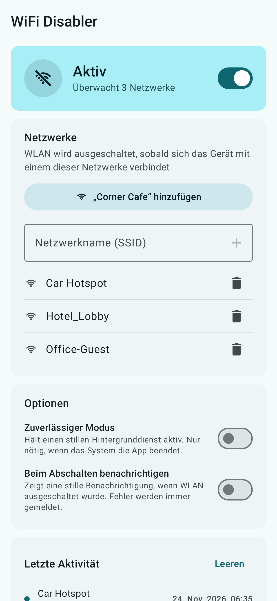
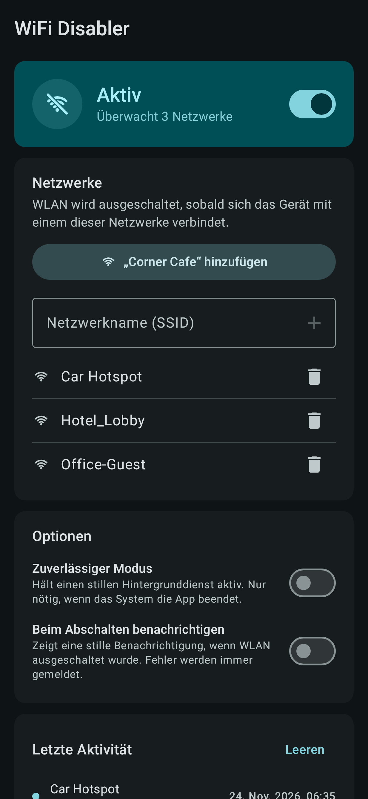
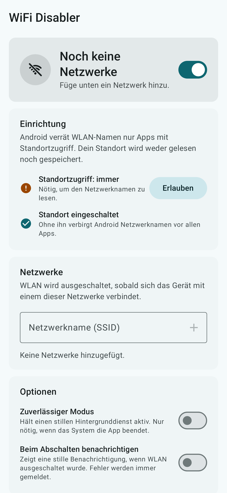

<div align="center">

🇩🇪 <b>Deutsch</b> &nbsp;·&nbsp; 🇬🇧 <a href="README.en.md">English</a>


# WiFi Disabler

**Schaltet WLAN automatisch aus, sobald sich dein Android-Gerät mit einem gewählten Netz verbindet.**

[Download](../../releases/latest) · [Einrichten](#einrichten) · [Funktionen](#funktionen)

</div>

<table>
<tr>
<td width="33%"></td>
<td width="33%"></td>
<td width="33%"></td>
</tr>
</table>

## Einrichten

Unter [Releases](../../releases/latest) die Datei `WiFi-Disabler-vX.Y.Z.apk` laden und installieren. Android bzw.
Play Protect warnt dabei, die App sei für eine ältere Android-Version gebaut. Das ist Absicht (siehe
[Warum Android 9?](#warum-android-9)), also *Trotzdem installieren* wählen.

1. **Netz hinzufügen:** Während der Verbindung *„…“ hinzufügen* tippen oder den Namen (SSID) eintippen.
2. **Standort › Immer zulassen:** Android verrät WLAN-Namen nur Apps mit Standortzugriff, auch im Hintergrund.
3. **Standort eingeschaltet lassen:** Ist er aus, verbirgt Android Netzwerknamen vor allen Apps.

Fertig. Die App zeigt nur Schritte an, die noch fehlen. Beendet das System die App im Hintergrund, helfen
*Akku › Keine Beschränkungen*, *Autostart* in den App-Einstellungen oder der **zuverlässige Modus** in der App.
Gerätespezifische Anleitungen gibt es auf [dontkillmyapp.com](https://dontkillmyapp.com).

> Wer nur nie wieder mit einem Netz verbunden werden will, braucht keine App: In den WLAN-Einstellungen das Netz
> entfernen oder *Automatisch verbinden* ausschalten.

## Funktionen

| | |
|---|---|
| **Netzwerkliste** | Aktuelles Netz mit einem Tipp hinzufügen oder SSID eintippen |
| **Unauffällig** | Keine Dauerbenachrichtigung, keine Rückfragen nach der Einrichtung |
| **Zuverlässiger Modus** | Optionaler stiller Hintergrunddienst für Systeme, die Apps beenden |
| **Kachel** | In den Schnelleinstellungen pausieren und fortsetzen |
| **Protokoll** | Die letzten 20 Abschaltungen, nur lokal |
| **Sprache** | Deutsch oder Englisch, wie das System |

## Warum Android 9?

Seit Android 10 dürfen nur noch Apps, die auf Android 9 (API 28) zielen, WLAN per `setWifiEnabled()` ausschalten.
Bei allen anderen passiert stillschweigend nichts, einen offiziellen Ersatz gibt es nur mit Root, Shizuku/ADB oder
Device-Owner. Die App zielt deshalb bewusst auf API 28. Das funktioniert ohne Root von Android 8 bis heute, verhindert
aber eine Veröffentlichung in Google Play. Sollte Android Apps mit diesem Ziel irgendwann nicht mehr installieren,
lässt sich ein Shizuku- oder Root-Weg ergänzen.

Grenzen: WLAN lässt sich erst *nach* dem Verbindungsaufbau ausschalten, ein paar Sekunden Datenverkehr über das Netz
sind also möglich. WLAN bleibt danach aus. Erkannt wird nur am Namen, jedes Netz mit derselben SSID löst aus.

## Datenschutz

Kein Konto, keine Werbung, kein Tracking und keine Internet-Berechtigung. Gespeichert werden nur die Netzwerkliste,
die Einstellungen und das Protokoll, ausschließlich auf dem Gerät.

Die Standortberechtigung dient nur dazu, den WLAN-Namen zu lesen, die App fragt nie eine Position ab.
Benachrichtigungen und Vordergrunddienst werden nur für den zuverlässigen Modus und die optionalen Hinweise genutzt.
Ist die Gerätesicherung von Android aktiv, kann das System die Einstellungen darin aufnehmen.

## Bauen

```sh
./gradlew assembleRelease
```

Jeder Push auf `main` baut die APK und veröffentlicht sie als Release.

## Lizenz

Der Code steht unter der [MIT-Lizenz](LICENSE). Mitgelieferte Bibliotheken haben eigene Lizenzen, siehe
[Drittanbieter-Hinweise](THIRD_PARTY_NOTICES.md).

Wi-Fi® ist eine eingetragene Marke der Wi-Fi Alliance, Android eine Marke von Google LLC. WiFi Disabler ist ein
unabhängiges Projekt und steht mit keinem davon in Verbindung. Das Icon ist eine eigene Gestaltung und nicht das
Wi-Fi-Logo.
